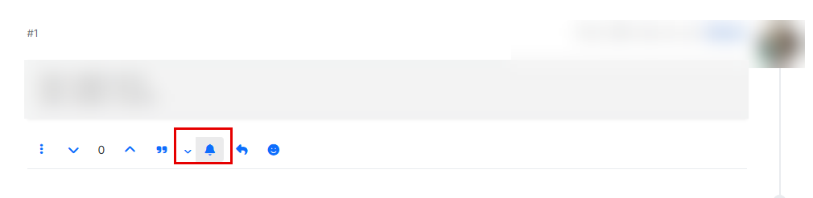
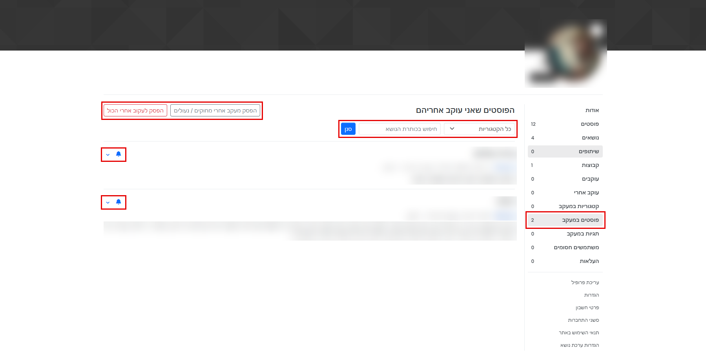
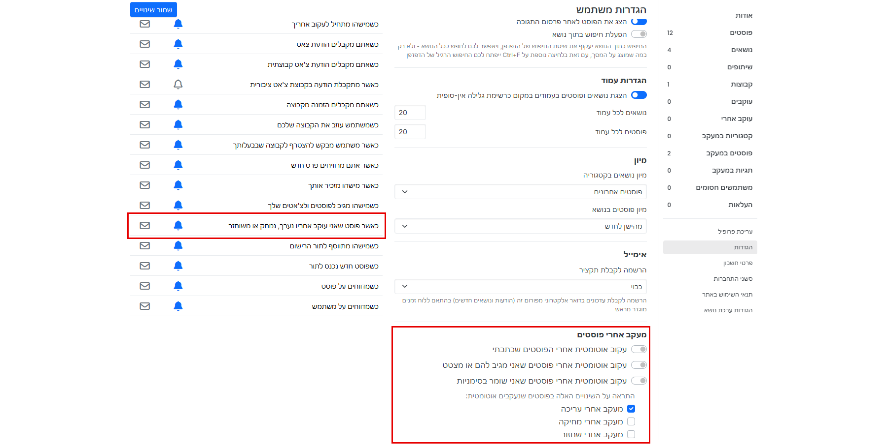
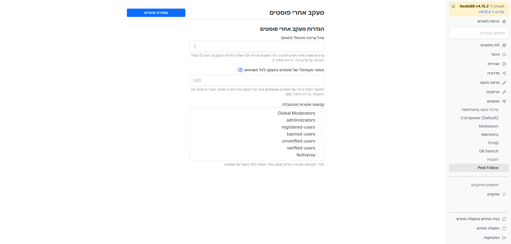

<div dir="rtl" align="right">

[English](README.md) | **עברית**

# nodebb-plugin-post-follow

מעקב אחר **פוסט בודד** במקום אחר נושא שלם, עם התראה רק כשהפוסט הזה נערך, נמחק או משוחזר.

## יכולות

- **כפתור פעמון ליד כפתור התגובה** בכל פוסט (סמל בלבד). לחיצה עליו מתחילה או מפסיקה מעקב. הודעה קופצת קצרה מאשרת את השינוי, ושום דבר לא נוסף ללוח ההתראות.
- **הגדרות לכל פוסט.** כשפוסט במעקב, מופיע חץ קטן ליד הפעמון. הוא פותח תפריט שבו בוחרים כל צירוף של: *מעקב אחרי עריכה*, *מעקב אחרי מחיקה*, *מעקב אחרי שחזור* (חייב להישאר לפחות אחד מסומן, ומעקב חדש מתחיל עם עריכה בלבד).
- **עמוד "הפוסטים שאני עוקב אחריהם"** בפרופיל (גלוי רק לך), עם אותו פעמון ואותן הגדרות בכל פריט.
- **מעקב אוטומטי**, בהגדרות החשבון: פוסטים שכתבתי, פוסטים שהגבתי להם או ציטטתי, ופוסטים ששמרתי בסימניות, עם בחירת האירועים.
- **ניהול הרשימה.** סינון עמוד הפוסטים במעקב לפי קטגוריה או כותרת נושא, סימון של פוסטים שנמחקו או שהנושא שלהם נמחק או נעול, וכפתורים *הפסק לעקוב אחרי הכול* ו*הפסק מעקב אחרי מחוקים / נעולים*.
- **בלי הצפת התראות.** כל עוד התראה על אותו פוסט ואותו אירוע עדיין לא נקראה, לא נשלחת למשתמש התראה חדשה.
- **סוג התראה נפרד.** בהגדרות ההתראות של כל משתמש מופיעה שורה "כאשר פוסט שאני עוקב אחריו נערך, נמחק או משוחזר", ובה בוחרים באתר, במייל, בשניהם או בכלל לא.
- **הגבלת מעקב.** מנהלי הפורום קובעים כמה פוסטים משתמש אחד יכול לעקוב אחריהם (ברירת מחדל: 500, הערך 0 מבטל את ההגבלה) ב-*ACP ← תוספים ← מעקב אחרי פוסטים*; סימן שאלה ליד ההגדרה מסביר למה היא קיימת. אפשר לפטור קבוצות מההגבלה. מעקבים קיימים אף פעם לא נמחקים.
- **התעלמות מעריכות זעירות.** מנהלי הפורום קובעים גודל עריכה מינימלי ב-*ACP ← תוספים ← מעקב אחרי פוסטים*. עריכות ששינו פחות תווים (ברירת מחדל: 3) לא שולחות התראה לעוקבים. הערך 0 שולח התראה על כל עריכה.

העורך עצמו לא מקבל התראה, וגם לא עוקבים שאין להם עוד הרשאת קריאה לנושא. נתוני המעקב נמחקים כשפוסט נמחק לצמיתות או כשהמשתמש נמחק.

בניגוד לצפייה בנושא, לא תקבל התראות על תגובות או על פוסטים אחרים בנושא.

### יחס לצפייה בנושא

ליבת NodeBB כבר שולחת התראת עריכה לכל מי שצופה בנושא כולו. כדי למנוע כפילויות, התוסף מדלג על התראות *עריכה* למשתמשים ש:

- צופים בנושא **וגם**
- סוג ההתראה של הליבה "כאשר פוסט נערך בנושא שאני צופה בו" מופעל אצלם.

משתמש שצופה בנושא אבל כיבה את סוג ההתראה הזה, או שאינו צופה בנושא כלל, ימשיך לקבל התראות מהתוסף על פוסטים שהוא עוקב אחריהם במפורש. כך אפשר לקבל "כל התגובות בנושא, ובנוסף עריכות של פוסט אחד". התראות מחיקה ושחזור נשלחות רק על ידי התוסף, ולכן הן אף פעם לא מדולגות.

## צילומי מסך

מסגרות אדומות מסמנות את החלקים שהתוסף מוסיף בתוך עמודי NodeBB; פרטים אישיים מטושטשים.

**פעמון והגדרות בכל פוסט**



**הפוסטים שאני עוקב אחריהם** (סינון, הפסקת מעקב קבוצתית, הגדרות לכל פוסט)



**הגדרות חשבון** (מעקב אוטומטי וסוג ההתראה הנפרד)



**הגדרות ניהול** (*ACP ← תוספים ← מעקב אחרי פוסטים*)



## התקנה

התוסף לא מפורסם ב-npm. מתקינים אותו ישירות מגיטהאב:

```bash
cd /path/to/nodebb
npm install github:hershaleh/nodebb-plugin-post-follow
```

לאחר מכן מפעילים אותו בלוח הניהול (הרחבות ← תוספים), בונים מחדש ומפעילים מחדש את NodeBB:

```bash
./nodebb build
./nodebb restart
```

## תאימות

נכתב עבור NodeBB 4.x (נבדק מול קוד גרסה 4.16) ועבור ערכת הנושא ברירת המחדל המבוססת Bootstrap 5 (Harmony). כפתור הפעמון נוסף לשורת הפעולות של הפוסט, ליד כפתור התגובה.

## שפות

כלולות `en-GB` ו-`he`. שפות אחרות חוזרות לאנגלית.

## רישיון

MIT

</div>
