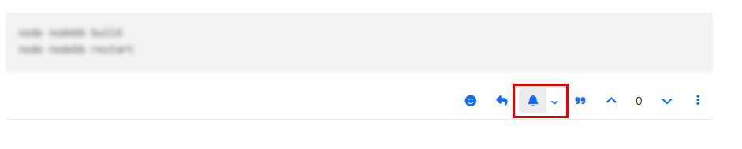
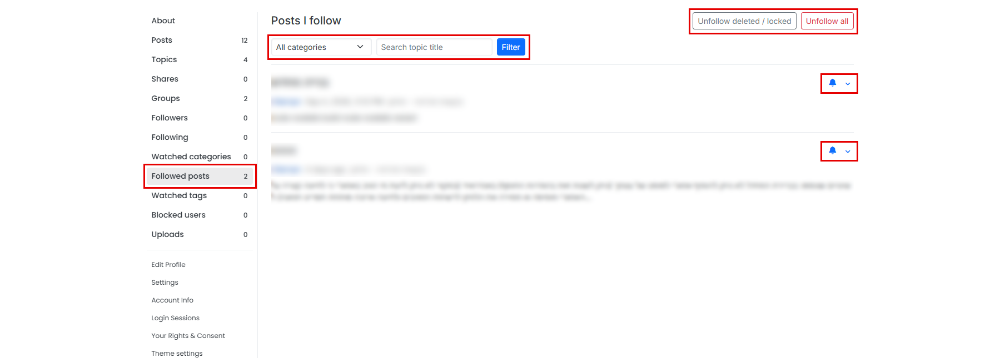
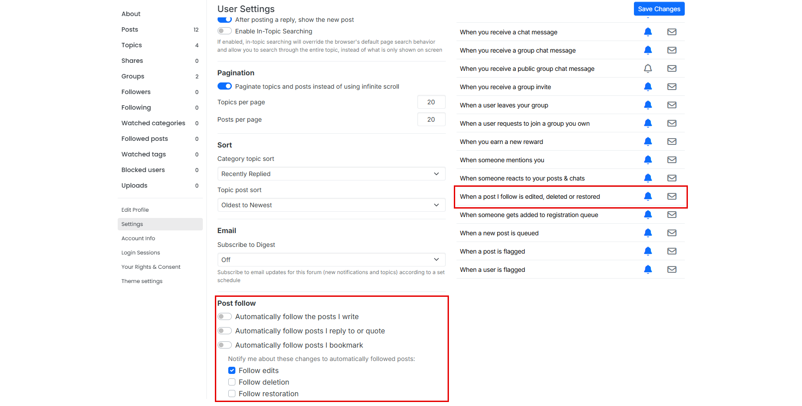
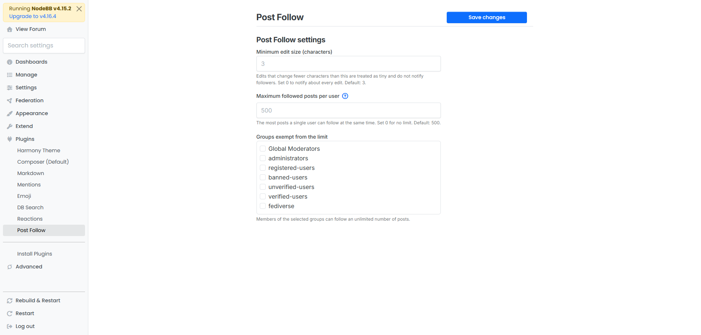

<div align="right">

**English** | [עברית](README.he.md)

</div>

# nodebb-plugin-post-follow

Follow a **single post** instead of a whole topic, and get notified only when that post is edited, deleted, restored or replied to, or when its topic is moved, locked, pinned or renamed.

## Features

- **Bell button next to the reply button** of every post (icon only). Click it to follow or unfollow the post. A short toast confirms the change; nothing is added to the notifications list.
- **Per-post settings.** A small arrow next to the bell opens a menu where you choose any combination of: *edits*, *deletion*, *restoration*, *direct replies* and *topic changes* (move, lock, pin; and the title when the post is the first post). At least one must stay selected; new follows start with edits only.
- **Bulk follow inside a topic.** The same menu can follow *all my posts*, *all posts by this author* or *all posts* of the topic in one click (the follow limit still applies).
- **"Posts I follow" page** in your profile (visible only to you), with the same bell and settings on every item. Filter by category and topic title, sort by recently followed, recently edited, post date or topic, see which posts were deleted or whose topic is deleted or locked, and use *Unfollow all* or *Unfollow deleted / locked*.
- **Follow automatically**, from your account settings: posts you write, posts you reply to or quote, and posts you bookmark, with a choice of events.
- **No notification pile-up.** While a notification about the same post and event is still unread, no new one is sent to that user.
- **Separate notification type.** Users get a "When something happens to a post I follow" row in their notification settings, where they can choose on-site, email, both or none.
- **Follow limit.** Admins cap how many posts one user can follow (default: 500, 0 = unlimited) in *ACP → Plugins → Post Follow*; a question-mark bubble next to the setting explains why. Groups can be exempted from the limit. Existing follows are never removed.
- **Statistics.** *ACP → Plugins → Post Follow* shows how many follows, followed posts and following users there are, the most followed posts, and how many notifications were sent (per event).
- **Where following is off.** Admins can switch following (bell and notifications) off for chosen categories, topics or single posts. Existing follows are kept.
- **Automatic cleanup.** A daily job removes follows of posts that no longer exist, and of deleted posts (or posts in deleted topics) after a grace period (default 30 days, 0 = keep). There is also a *Run cleanup now* button.
- **REST API** (off by default, with a ? explanation in the settings): `GET /api/v3/plugins/post-follow/posts`, and `GET`, `PUT`, `DELETE /api/v3/plugins/post-follow/posts/:pid`, authenticated with a NodeBB API token or a session. Other plugins can use `require.main.require('nodebb-plugin-post-follow').api` (`follow`, `unfollow`, `isFollowing`, `getFollowedPids`) and listen to the `action:post-follow.follow` / `action:post-follow.unfollow` hooks. Everything obeys the same privileges, follow limit and blocklist as the website.
- **Ignore tiny edits.** Admins set a minimum edit size in *ACP → Plugins → Post Follow*. Edits that change fewer characters (default: 3) do not notify followers. Set 0 to notify about every edit.

The editor never notifies themselves, and followers who can no longer read the topic are skipped. Follow data is removed when a post is permanently deleted or when the user is deleted.

Unlike topic watching, you are not notified about replies or about other posts in the topic.

### Interaction with topic watching

NodeBB core already sends an edit notification (and a new-reply notification) to everyone who watches the whole topic. To avoid duplicates, this plugin skips *edit* and *reply* notifications for users who:

- watch the topic **and**
- have the matching core notification type ("When a post is edited in a watched topic" / "When someone replies in a watched topic") enabled.

A user who watches the topic but turned that notification type off, or who does not watch the topic at all, still receives this plugin's notifications for the posts they explicitly follow. This is what makes "all replies in the topic, plus edits of this one post" possible. Deletion and restoration notifications are only sent by this plugin, so they are never skipped.

## Screenshots

Red frames mark the parts added by this plugin inside NodeBB pages; personal details are blurred.

**Bell and options on every post**



**Posts I follow** (filter, bulk unfollow, per-post settings)



**Account settings** (automatic following and the separate notification type)



**Admin settings** (*ACP → Plugins → Post Follow*)



## Installation

The plugin is not published on npm. Install it straight from GitHub:

```bash
cd /path/to/nodebb
npm install github:hershaleh/nodebb-plugin-post-follow
```

Then activate it in the ACP (Extend → Plugins) and rebuild and restart NodeBB:

```bash
./nodebb build
./nodebb restart
```

## Compatibility

Written for NodeBB 4.x (checked against the 4.16 source) and the Bootstrap 5 based default theme (Harmony). The bell button is added to the post actions bar next to the reply button.

## Languages

`en-GB`, `he`, `ar`, `ru` and `es` are included. The Arabic, Russian and Spanish texts were translated by a machine, so corrections from native speakers are very welcome: edit `languages/<code>/post-follow.json` and open a pull request, or open an issue. To add another language, copy `languages/en-GB` to a new folder named after the NodeBB language code and translate the values (keep the `%1`, `%2`, `%3` placeholders and the `<strong>` tags). Missing languages fall back to English.

## License

MIT
